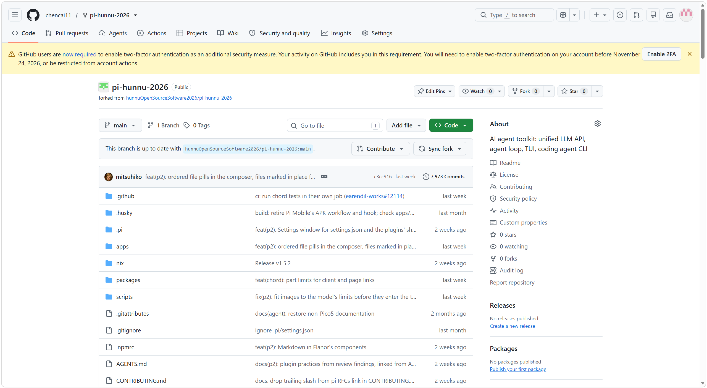
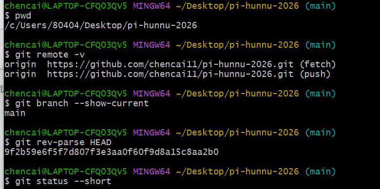
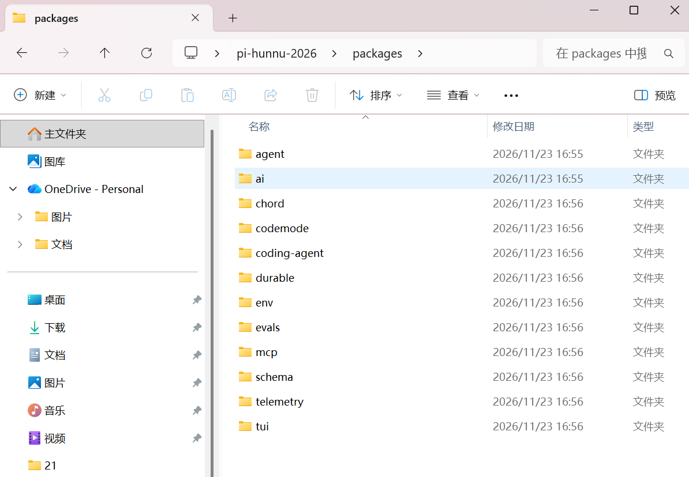
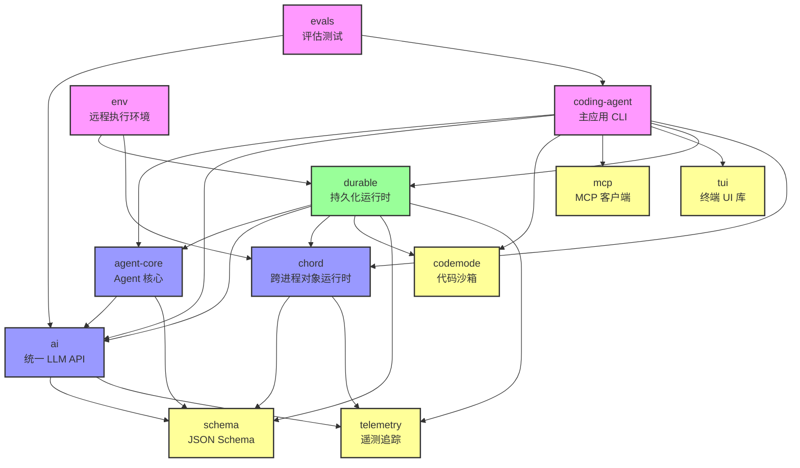
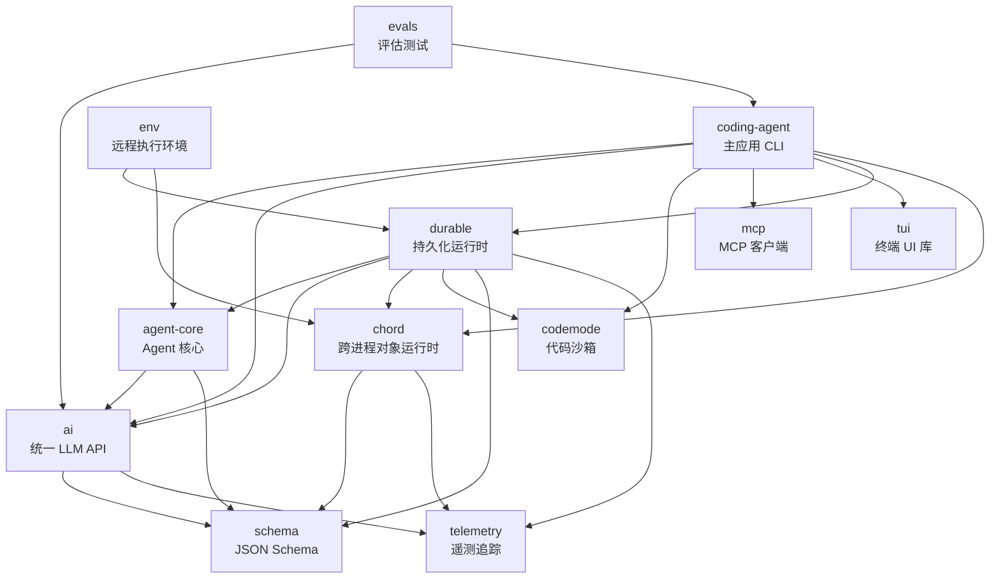

# 实践课2：组织建仓与源码分析

> 姓名：陈光彩（chencai170）
> 角色：组长
> 小组组织：chencai11
> 日期：2026-11-23

---

## 一、任务一：组长 Fork 仓库到小组组织

### 1.1 操作过程

作为组长，我将课程仓库 fork 到了本小组的 Organization 中。

**操作步骤：**

1. 打开课程仓库：[hunnuOpenSourceSoftware2026/pi-hunnu-2026](https://github.com/hunnuOpenSourceSoftware2026/pi-hunnu-2026)
2. 点击右上角 **Fork** 按钮
3. Owner 选择本小组组织 **chencai11**
4. 仓库名保持 `pi-hunnu-2026` 不变
5. 点击 **Create fork** 完成创建

Fork 页面中选择 Owner 为 `chencai11` 组织，仓库名保持 `pi-hunnu-2026`。

### 1.2 结果

成功将课程仓库 fork 到小组组织，仓库地址为：

- **小组组织仓库**：[https://github.com/chencai11/pi-hunnu-2026](https://github.com/chencai11/pi-hunnu-2026)
- **上游仓库**：[hunnuOpenSourceSoftware2026/pi-hunnu-2026](https://github.com/hunnuOpenSourceSoftware2026/pi-hunnu-2026)

**小组仓库首页截图：**



### 1.3 组员权限确认

已确认小组成员都已加入 `chencai11` 组织，并具有仓库的写权限，可以正常推送代码和创建 PR。

---

## 二、任务二：下载课程仓库源码

### 2.1 克隆源码

在本地建立实验目录，从小小组组织仓库克隆源码：

```bash
git clone --branch main https://github.com/chencai11/pi-hunnu-2026.git
cd pi-hunnu-2026
```

### 2.2 确认源码来源和版本

执行以下命令验证仓库信息：

```powershell
Get-Location
git remote -v
git branch --show-current
git rev-parse HEAD
git status --short
```

**实际输出结果：**

```
/c/Users/80404/Desktop/pi-hunnu-2026

origin  https://github.com/chencai11/pi-hunnu-2026.git (fetch)
origin  https://github.com/chencai11/pi-hunnu-2026.git (push)

main

9f2b59e6f5f7d807f3e3aa0f60f9d8a15c8aa2b0

（干净工作区，无输出）
```

**验证结果：**
- ✅ origin 指向小组组织 `chencai11/pi-hunnu-2026`
- ✅ 当前分支为 `main`
- ✅ 最新提交编号：`9f2b59e6f5f7d807f3e3aa0f60f9d8a15c8aa2b0`
- ✅ 工作区干净

**截图 S1**：



### 2.3 源码目录结构

```
pi-hunnu-2026/
├── packages/
│   ├── agent/          # Agent 核心
│   ├── ai/             # 统一 LLM API
│   ├── chord/          # 跨进程对象运行时
│   ├── codemode/       # 代码模式（JS沙箱）
│   ├── coding-agent/   # 主应用：编码 Agent CLI
│   ├── durable/        # 持久化 Agent 运行时
│   ├── env/            # 远程执行环境
│   ├── evals/          # 评估测试套件
│   ├── mcp/            # Model Context Protocol 客户端
│   ├── schema/         # JSON Schema 验证器
│   ├── telemetry/      # 遥测工具
│   └── tui/            # 终端 UI 库
├── scripts/            # 构建脚本
├── package.json        # 根目录配置（monorepo workspaces）
├── README.md
└── CONTRIBUTING.md
```

**源码目录结构截图：**



---

## 三、任务三：分析子模块功能与依赖关系

### 3.1 构建顺序

项目使用 npm workspaces 的 monorepo 结构，构建需要遵循**依赖拓扑顺序**：被依赖的模块先构建，依赖它的模块后构建。

**构建批次划分：**

| 构建批次 | 模块 | 原因 |
|---------|------|------|
| **第1批（可并行）** | schema, telemetry, codemode, mcp, tui | 无任何内部依赖，最底层基础模块 |
| **第2批** | ai, chord | 依赖第1批的 schema 和 telemetry |
| **第3批** | agent-core | 依赖 ai 和 schema |
| **第4批** | durable | 依赖 ai、chord、codemode、schema、telemetry、agent-core |
| **第5批** | env, coding-agent, evals | 应用层，依赖前面各层的模块 |

### 3.2 模块分析表

| 子文件夹 | 包名 | 代码主要实现什么功能 | 本模块 build 执行什么、生成什么 | 直接依赖哪些内部模块 | 依据文件或代码位置 |
|---------|------|-------------------|------------------------------|-------------------|-----------------|
| **schema** | `@earendil-works/pi-schema` | JSON Schema 验证器，无 eval，将 schema 编译为纯闭包函数，支持 Draft 2020-12 和 7 标准。体积很小（8.5 KB 压缩），用于数据结构的类型校验。是整个项目数据一致性的基础。 | 执行 `tsc -p tsconfig.build.json`，将 TypeScript 源码编译为 JavaScript，生成 `dist/` 目录，包含 `index.js` 和 `formats.js` 等入口文件。 | 无（最底层模块） | `packages/schema/package.json`<br>`packages/schema/src/compiler.ts` |
| **telemetry** | `@earendil-works/pi-telemetry` | 厂商中立的遥测契约和类型化 schema 工具。提供 TelemetryContext/TelemetrySpan（追踪上下文）、指标收集、跨进程传播能力，还有内存参考实现用于测试。 | 执行 `tsc -p tsconfig.build.json`，编译 TypeScript 到 `dist/` 目录，导出 `index.js`、`render.js`、`testing.js`。 | 无（最底层模块） | `packages/telemetry/package.json`<br>`packages/telemetry/src/context.ts` |
| **ai** | `@earendil-works/pi-ai` | 统一的 LLM API 抽象层。支持多家模型供应商（OpenAI、Anthropic、Gemini、Bedrock 等），自动认证、Token/成本追踪、流式工具调用、图片输入/生成、思维链等功能。屏蔽了不同厂商 API 的差异。 | 先执行 `npm run generate-models` 生成模型列表，再执行 `npm run build:offline`（内部是 tsc 编译），生成 `dist/` 目录，包含主入口和多个子路径导出（models、providers、api 等）。 | `@earendil-works/pi-schema`（工具参数验证）<br>`@earendil-works/pi-telemetry`（请求追踪） | `packages/ai/package.json` 的 dependencies<br>`packages/ai/src/providers/` |
| **chord** | `@earendil-works/chord` | 跨进程对象运行时（Chord = Contract + Hosted Object Runtime Document）。提供契约定义、文档存储、对象链接、热重载插件，支持 HTTP、Worker、Web 和终端客户端。是 Pi 的状态管理和跨进程通信核心。 | 执行 `tsc -p tsconfig.build.json`，编译 TypeScript 到 `dist/` 目录，有大量子路径导出（context、delta、json、sqlite、http、workers、plugins、app、web、react、tui、sync 等）。 | `@earendil-works/pi-schema`（契约定义验证）<br>`@earendil-works/pi-telemetry`（跨进程追踪） | `packages/chord/package.json` 的 dependencies<br>`packages/chord/src/` |
| **tui** | `@earendil-works/pi-tui` | 终端 UI 组件库。支持差分渲染（只更新变化的部分，减少终端闪烁）、同步输出、Kitty/iTerm2 内联图片。内置丰富组件：Text、Editor、Markdown、SelectList、Image、VStack、HStack、ScrollView 等。 | 执行 `tsc -p tsconfig.build.json`，编译 TypeScript 到 `dist/index.js`。 | 无（独立 UI 库） | `packages/tui/package.json`<br>`packages/tui/src/components/` |
| **codemode** | `@earendil-works/pi-codemode` | 代码模式：在 QuickJS VM（编译为 WASM）中运行模型生成的 JavaScript 代码。唯一能力是调用注入的工具，安全沙箱执行，防止 AI 生成的代码破坏系统。支持 Node/Bun Worker 和 Cloudflare Workers。 | 执行 `tsc -p tsconfig.build.json`，编译 TypeScript 到 `dist/` 目录，导出 `index.js`、`declarations.js`、`source.js`、`portable.js`、`cloudflare.js`、`worker.js`。 | 无（独立沙箱模块） | `packages/codemode/package.json`<br>`packages/codemode/src/vm/` |
| **mcp** | `@earendil-works/pi-mcp` | 独立的 Model Context Protocol（MCP）客户端实现，不依赖官方 MCP SDK。支持 stdio、Streamable HTTP、Pipe 和内存测试传输方式。用于连接外部 MCP 服务器获取工具和资源。 | 执行 `tsc -p tsconfig.build.json`，编译 TypeScript 到 `dist/` 目录，导出 `index.js`、`oauth.js`、`testing.js`。 | 无（独立协议实现） | `packages/mcp/package.json`<br>`packages/mcp/src/client.ts` |
| **agent** | `@earendil-works/pi-agent-core` | 通用 Agent 核心模块。提供传输抽象、状态管理、附件支持、事件流、工具执行等基础能力。构建于 pi-ai 之上，是具体 Agent 实现的基类。 | 执行 `tsc -p tsconfig.build.json`，编译 TypeScript 到 `dist/index.js`。 | `@earendil-works/pi-ai`（模型调用）<br>`@earendil-works/pi-schema`（消息 schema 验证） | `packages/agent/package.json` 的 dependencies<br>`packages/agent/src/agent.ts` |
| **durable** | `@earendil-works/pi-durable` | 持久化 Agent 运行时。对话、模型轮次、工具调用和自定义状态全部持久化存储到 SQLite，进程崩溃后可以恢复继续执行。是 Pi 的核心运行时，连接了模型、工具、存储等各个模块。 | 执行 `tsc -p tsconfig.build.json`，编译 TypeScript 到 `dist/` 目录，有大量子路径导出（env、codemode、tool-search、tools、images、storage 等）。 | `@earendil-works/pi-schema`<br>`@earendil-works/pi-telemetry`<br>`@earendil-works/pi-ai`<br>`@earendil-works/chord`<br>`@earendil-works/pi-codemode`<br>`@earendil-works/pi-agent-core` | `packages/durable/package.json` 的 dependencies<br>`packages/durable/src/runtime/` |
| **env** | `@earendil-works/pi-env` | 远程执行环境。通过 SSH 部署一个小型 Rust 守护进程，为 Pi Durable 提供远程命令执行、文件操作、PTY 终端、MCP 进程托管等能力。实现了"本地思考，远程执行"的模式。 | 执行 `tsc -p tsconfig.build.json`，编译 TypeScript 到 `dist/index.js`。 | `@earendil-works/chord`（对象传输协议）<br>`@earendil-works/pi-durable`（持久化运行时） | `packages/env/package.json` 的 dependencies<br>`packages/env/src/` |
| **coding-agent** | `@earendil-works/pi-coding-agent` | **Pi 主应用**：编码 Agent CLI。提供 read/bash/edit/write 工具、会话管理、TUI 交互界面、MCP 集成、代码模式、技能系统、主题定制等完整功能。是用户直接使用的 `pi` 命令入口。 | 先执行 `npm run build:unbundled`（tsc 编译），再执行 `node ../../scripts/build-coding-agent-bundle.mjs`（使用 esbuild 打包成单文件 bundle），生成 `dist/` 和 `dist/bundle/cli.js`。 | `@earendil-works/pi-ai`<br>`@earendil-works/pi-codemode`<br>`@earendil-works/pi-mcp`<br>`@earendil-works/pi-tui`<br>`@earendil-works/pi-agent-core`<br>`@earendil-works/chord`<br>`@earendil-works/pi-durable` | `packages/coding-agent/package.json` 的 dependencies<br>`packages/coding-agent/src/cli/` |

---

### 3.3 模块层级与依赖关系图

下图使用 Mermaid 绘制，箭头方向为 **使用方 → 被依赖方**。



**可编辑 Mermaid 源码：**



**层级划分依据：**

| 层级 | 模块 | 划分依据 |
|------|------|---------|
| **应用层** | coding-agent、env、evals | 面向最终用户或特定场景的完整应用，直接被外部调用或使用 |
| **运行时层** | durable | 提供 Agent 运行时环境，承上启下，整合核心能力 |
| **核心服务层** | agent-core、ai、chord | 提供核心业务能力，被运行时和应用层调用 |
| **基础设施层** | schema、telemetry、tui、codemode、mcp | 最底层，无内部依赖或极少依赖，提供通用基础功能 |

---

## 四、原理理解

### 问题 1：根目录与子模块中的 npm run build 分别读取什么配置、执行什么工作？

**根目录的 build：**

根目录的 `package.json` 中定义了总构建脚本，它读取的配置包括：

- **`package.json`**：定义 `workspaces` 字段（列出所有子包路径 `packages/*`），以及根级别的构建脚本
- **`tsconfig.base.json`**：TypeScript 基础配置，所有子包的 tsconfig 都继承这个基础配置
- **`scripts/` 目录**：自定义构建脚本，例如 `build-coding-agent-bundle.mjs` 用于打包 coding-agent 的 CLI 单文件

根目录 build 的工作：
1. 发现所有 workspace 子包（通过 `packages/*` 匹配）
2. 分析依赖关系，进行**拓扑排序**，确定构建顺序
3. 按顺序进入每个子包执行 `npm run build`
4. 对于特殊模块（如 coding-agent），还会执行额外的打包脚本
5. 构建完成后，子包之间通过 `node_modules` 中的符号链接互相引用

**子模块的 build：**

每个子模块有自己独立的 build 配置：

- **`package.json`**：定义 `scripts.build` 字段，指定该模块的构建命令
- **`tsconfig.build.json`**：该模块专属的 TypeScript 编译配置，指定输入目录（通常是 `src/`）、输出目录（`dist/`）、编译选项等
- **`tsconfig.json`**：开发时使用的配置，通常继承 base 配置并包含测试文件

子模块 build 的工作：
1. **大多数模块**：执行 `tsc -p tsconfig.build.json`，将 `src/` 下的 TypeScript 源码编译为 JavaScript，输出到 `dist/` 目录
2. **ai 模块**：先执行 `generate-models` 脚本生成模型列表文件，再执行 tsc 编译
3. **coding-agent**：先用 tsc 编译（`build:unbundled`），再用 esbuild 打包成单文件 bundle（方便作为 CLI 工具分发）
4. 构建产物放在各自的 `dist/` 目录，入口文件由 `package.json` 的 `main` 或 `exports` 字段指定

---

### 问题 2：构建顺序和模块依赖有什么关系？相邻构建的模块是否一定互相依赖？

**构建顺序与模块依赖的关系：**

构建顺序由**依赖关系的拓扑排序**决定。核心原则是：**被依赖的模块必须先构建完成，依赖它的模块才能开始构建**。

举个具体的例子：
- `schema` 没有任何内部依赖，所以第一批就构建
- `ai` 依赖 `schema`，所以必须等 `schema` 构建完才能构建 `ai`
- `durable` 依赖 `ai`，所以必须等 `ai` 构建完才能构建 `durable`
- `coding-agent` 依赖 `durable`，所以最后才构建

这就像盖房子的顺序：先打地基 → 再建主体结构 → 然后装内部设施 → 最后装修入住。顺序不能乱，不然上面的层没有下面的支撑就会"塌"（编译报错：找不到依赖的模块）。

**相邻构建的模块不一定互相依赖。**

这是一个常见的误区。举几个反例：

1. **第一批的 5 个模块**：schema、telemetry、codemode、mcp、tui 都是第一批构建的，它们"相邻"构建，但它们之间**完全没有依赖关系**。它们只是恰好都处于最底层，没有内部依赖，所以被放在同一批可以并行构建。

2. **ai 和 chord**：都是第二批构建的，相邻但不互相依赖。它们都依赖 schema 和 telemetry，但彼此独立。

所以正确的理解是：
- ✅ **A 依赖 B → B 必须在 A 之前构建**（充分必要条件）
- ❌ **B 在 A 之前构建 → A 依赖 B**（不成立，可能只是恰好同层）
- ❌ **相邻构建的模块 → 有依赖关系**（不成立）

---

### 问题 3：选择一条涉及至少三个模块的依赖路径，说明这些模块如何分工。

我选择的依赖路径：**`coding-agent → durable → ai → schema`**（共 4 个模块）

各模块分工说明：

#### 第 1 层：coding-agent（用户交互层）

**角色**：面向用户的前端入口，直接与用户交互

**分工**：
- 提供命令行界面（CLI）和终端 UI（TUI），用户通过它与 AI 对话
- 接收用户输入（比如"帮我写个 Python 脚本"），显示 AI 的回复
- 管理会话列表、历史记录、用户配置
- 整合各种能力：代码编辑、文件操作、MCP 外部工具、技能系统、主题定制
- 把用户的需求组织成 Agent 能理解的格式，交给 durable 层处理
- 展示运行结果、进度、错误信息等

**类比**：就像餐厅的前台服务员，接待顾客、记录菜单、上菜、跟顾客沟通，是顾客唯一直接接触的人。

---

#### 第 2 层：durable（运行时调度层）

**角色**：持久化运行时，任务调度和状态管理中枢

**分工**：
- 管理 Agent 的整个生命周期：对话轮次、工具调用、状态保存
- **持久化存储**：把对话状态、模型返回、工具调用结果全部存到 SQLite 数据库
- **崩溃恢复**：如果程序意外退出，下次启动能从断点继续执行，不用重来
- **工具执行调度**：协调各种工具的调用，包括本地工具和 MCP 外部工具
- 调用 **ai** 模块与大模型对话，调用 **chord** 管理状态对象，调用 **codemode** 执行代码
- 是整个系统的"大脑中枢"，协调各个模块协同工作

**类比**：就像餐厅的后厨主管/厨师长，接到服务员的订单后，安排切配、热菜、凉菜等各个工位协作，把控整个做菜流程，还能记住顾客的特殊要求。如果中途出了问题，也能从当前状态继续，不用从头开始。

---

#### 第 3 层：ai（模型服务层）

**角色**：统一大模型 API，与各厂商 AI 模型对话

**分工**：
- **统一接口**：封装多家模型供应商（OpenAI、Anthropic、Gemini、Bedrock 等），上层只需要调用一套 API
- 处理认证、流式响应解析、工具调用格式转换
- **Token 计数和成本追踪**：记录每次请求消耗的 token 和费用
- 把 durable 发来的消息组装成请求发送给大模型，把模型的回复解析成结构化数据返回
- 使用 **schema** 验证工具调用的参数格式是否正确
- 使用 **telemetry** 记录请求追踪信息和性能指标

**类比**：就像餐厅的食材供应商对接员，负责和不同的食材供应商（大模型厂商）沟通，拿到食材（模型回复）后检查质量，再统一交付给后厨。

---

#### 第 4 层：schema（基础验证层）

**角色**：数据结构验证，保证数据格式正确

**分工**：
- 提供 JSON Schema 验证能力，将 schema 编译成高效的验证函数（纯闭包，没有 eval）
- **ai 模块**用它来验证工具调用的参数是否符合预期的格式
- **chord 模块**用它来验证契约定义的数据结构
- 确保模型返回的工具调用格式正确，不会因为格式错误导致程序崩溃
- 支持 Draft 2020-12 和 7 标准，体积很小（8.5 KB 压缩），性能很高

**类比**：就像餐厅的质检员，检查每一份食材和菜品是否符合规格标准，保证上桌的菜质量合格，不会因为食材问题导致顾客吃坏肚子。

---

**完整的调用流程（以"让 AI 读取一个文件"为例）：**

```
用户输入 "帮我读一下 README.md 文件"
    │
    ▼
coding-agent（接收输入，在 TUI 界面显示用户消息）
    │
    ▼
durable（创建/恢复会话，调度 Agent 处理消息）
    │
    ▼
ai（调用大模型，把消息发给 LLM）
    │
    ▼
LLM 返回："我需要调用 read_file 工具，参数是 {path: 'README.md'}"
    │
    ▼
ai + schema（用 schema 验证工具参数格式是否正确）
    │
    ├─ 验证通过 → 继续执行
    │
    ▼
durable（执行 read_file 工具，读取文件内容）
    │
    ▼
durable（把工具结果再发给 ai，让模型生成最终回复）
    │
    ▼
ai（再次调用 LLM，带上工具返回结果）
    │
    ▼
LLM 生成最终回答
    │
    ▼
durable（保存本轮对话状态到数据库）
    │
    ▼
coding-agent（把 AI 的回复显示在终端界面上给用户看）
```

---

## 五、个人重点分析模块

我重点分析了以下模块：

### 1. durable 模块（重点）

durable 是整个系统最核心的模块，它连接了 ai、chord、codemode、agent-core 等多个模块，是承上启下的关键。我阅读了 `packages/durable/src/runtime/` 下的代码，理解了持久化运行时的实现原理：通过 SQLite 存储所有状态，每次对话轮次都保存到数据库，崩溃后可以从最近的检查点恢复。

### 2. ai 模块

ai 模块的多供应商抽象设计非常巧妙。通过统一的接口定义，上层代码不需要关心底层用的是 OpenAI 还是 Anthropic，切换模型只需要改配置。我分析了 `packages/ai/src/providers/` 下的各个 provider 实现，了解了它们如何适配不同厂商的 API。

### 3. schema 模块

schema 虽然是最底层的小模块，但它的设计非常精巧。把 JSON Schema 编译成纯闭包函数，不用 eval，既安全又高效。我觉得这个模块虽然小，但体现了整个项目对代码质量的追求。

---

## 六、总结与体会

通过本次实践，我完成了从组织建仓到源码分析的完整流程。作为组长，我负责了仓库的 fork 和组员权限管理；作为开发者，我深入分析了 Pi Agent 的 11 个核心模块。

**主要收获：**

1. **monorepo 架构的魅力**：使用 npm workspaces 管理 12 个子包，每个模块独立发布又能方便地本地联调，这种架构非常适合大型项目。

2. **分层设计的重要性**：四层架构（基础设施→核心服务→运行时→应用）让代码职责分明，每层只依赖下面的层，不会出现循环依赖，维护起来很清晰。

3. **durable 设计的巧妙**：持久化运行时是整个系统的灵魂。"崩溃可恢复"这个特性看似简单，但实现起来需要对状态管理有很深的理解。这让我对 Agent 系统有了全新的认识——原来 Agent 不只是调用 API，还要考虑状态持久化、错误恢复这些工程问题。

4. **从底层到应用的完整视角**：以前我只关注上层应用怎么写，这次通过分析 schema 这种底层模块，意识到基础设施的质量决定了整个系统的上限。一个好的基础工具能让上层开发事半功倍。

5. **组长的责任**：作为组长，不仅要自己完成任务，还要确保整个小组的仓库配置正确、组员权限到位、大家都能正常访问。这锻炼了我的组织协调能力。

这次源码阅读为后续的团队开发打下了很好的基础，我对 Pi 的架构有了比较全面的理解。

---

## 七、参考链接

- 课程原仓库：[hunnuOpenSourceSoftware2026/pi-hunnu-2026](https://github.com/hunnuOpenSourceSoftware2026/pi-hunnu-2026)
- 小组仓库：[chencai11/pi-hunnu-2026](https://github.com/chencai11/pi-hunnu-2026)
- Pi 官网：[https://pi.dev/](https://pi.dev/)
- 最新提交：`9f2b59e6f5f7d807f3e3aa0f60f9d8a15c8aa2b0`
