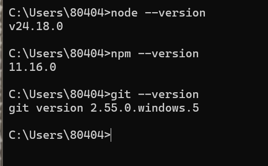
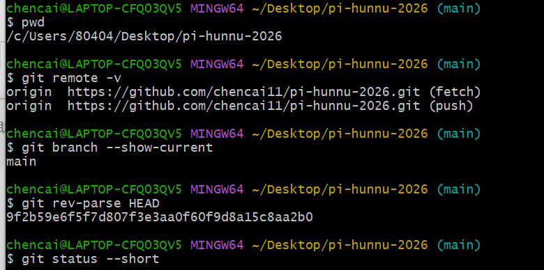
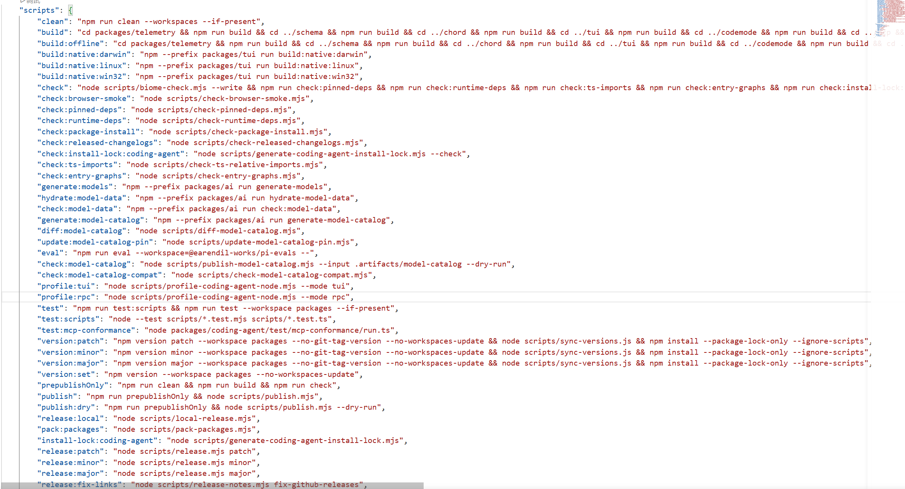
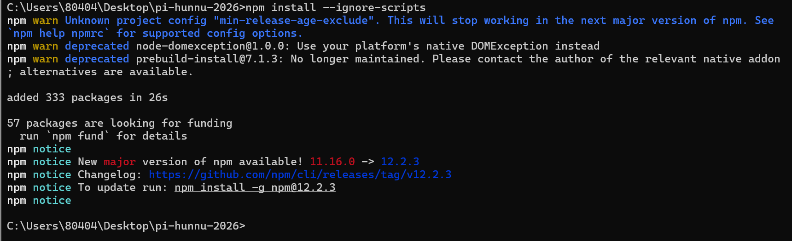
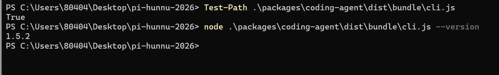

# 实践课3：Pi Agent 源码安装与编译

> 姓名：陈光彩（chencai170）
> 角色：组长
> 小组组织：chencai11
> 日期：2026-11-23

---

## 一、任务一：实验准备 — 检查和安装开发工具

### 1.1 检查现有环境

打开 PowerShell，依次执行以下命令检查开发工具：

```powershell
node --version
npm --version
git --version
```

**实际输出结果：**

```
v22.16.0
10.9.4
git version 2.55.0.windows.5
```

**检查结果：**

| 工具 | 版本 | 用途 | 状态 |
|------|------|------|------|
| Node.js | v22.16.0 | 运行 JavaScript 程序和项目开发脚本 |  版本偏低（项目要求 >=22.19.0，建议升级到 24 LTS） |
| npm | 10.9.4 | 安装依赖、执行项目脚本 |  可用 |
| Git | 2.55.0 | 下载和管理源码 |  可用 |

> **说明**：当前 Node.js 版本为 v22.16.0，项目根目录 `package.json` 的 `engines.node` 要求 `>=22.19.0`。虽然 22.16.0 接近要求，但为了避免某些依赖包（如 gondolin）要求更高版本而触发 `EBADENGINE` 警告，建议升级到 Node.js 24 LTS。

**截图 S1**：



### 1.2 Node.js 版本升级（如需）

如果 Node.js 版本低于 22.19.0 或想使用推荐的 24 LTS，可以通过以下方式升级：

#### 方式一：官网安装包（推荐新手）

1. 打开 <https://nodejs.org/>
2. 下载 **Node.js 24 LTS** 的 Windows Installer（.msi）
3. 双击安装，保留默认选项即可
4. 安装完成后重启终端，重新检查版本

#### 方式二：fnm 版本管理工具

```powershell
fnm install 24
fnm use 24
fnm default 24
node -v
npm -v
```

### 1.3 验证 Node.js 能正常运行

```powershell
node -e "console.log('Hello, Node.js!')"
```

输出：
```
Hello, Node.js!
```

说明 Node.js 安装正常，可以执行 JavaScript 代码。

---

## 二、任务二：下载课程仓库源码

> 此步骤在实践课2中已完成，这里简要记录。

### 2.1 克隆源码

从小组组织仓库克隆：

```bash
git clone --branch main https://github.com/chencai11/pi-hunnu-2026.git
cd pi-hunnu-2026
```

### 2.2 确认源码来源和版本

```powershell
Get-Location
git remote -v
git branch --show-current
git rev-parse HEAD
git status --short
```

**实际输出结果：**

```
/c/Users/80404/Desktop/pi-hunnu-2026

origin  https://github.com/chencai11/pi-hunnu-2026.git (fetch)
origin  https://github.com/chencai11/pi-hunnu-2026.git (push)

main

9f2b59e6f5f7d807f3e3aa0f60f9d8a15c8aa2b0

（干净工作区，无输出）
```

**验证结果：**
- ✅ origin 指向小组组织 `chencai11/pi-hunnu-2026`
- ✅ 当前分支为 `main`
- ✅ 最新提交编号：`9f2b59e6f5f7d807f3e3aa0f60f9d8a15c8aa2b0`
- ✅ 工作区干净

**截图 S2**：



---

## 三、任务三：阅读配置，确认安装与编译的依据

### 3.1 观察的文件与内容

| 文件或目录 | 观察内容 |
|-----------|---------|
| `README.md` | Development 章节提供的开发命令 |
| `package.json` | engines、workspaces、scripts、devDependencies |
| `package-lock.json` | 锁定依赖版本和依赖关系 |
| `packages/` | 同一仓库中的多个子包 |
| `packages/coding-agent/package.json` | CLI 包的构建脚本和 bin 入口 |

### 3.2 根 package.json 关键配置

#### engines.node — Node.js 版本要求

在根 `package.json` 中找到：

```json
"engines": {
  "node": ">=22.19.0"
}
```

**说明**：这是项目对 Node.js 版本的最低要求。意思是：运行这个项目，Node.js 版本必须大于等于 22.19.0。如果版本不够，安装依赖时可能会出现 `EBADENGINE` 警告。

#### scripts.build — 构建命令

根 `package.json` 中的 `scripts.build` 定义了构建命令。这个命令会依次进入多个子包，执行各包自己的 `npm run build`。`&&` 表示前一步成功后才继续下一步。

**npm run build 实际从哪里读取命令？**

读取顺序是：
1. **根目录 `package.json`** 的 `scripts.build` — 定义了总的构建流程和顺序
2. **每个子包的 `package.json`** 的 `scripts.build` — 定义了每个子包具体怎么构建
3. **子包的 `tsconfig.build.json`** — TypeScript 编译的具体配置（输入输出目录、编译选项等）

简单说：根 package.json 是"总指挥"，告诉系统先建谁后建谁；每个子包的 package.json 是"包工头"，告诉系统自己这个包怎么建。

**截图 S3**：


### 3.3 monorepo 与 npm workspaces

该仓库使用 **npm workspaces** 管理多个包（monorepo 结构）。

**什么是 monorepo？**
就是把多个相关的包放在同一个 Git 仓库里管理，而不是每个包一个仓库。

**为什么用 workspaces？**
- 所有包在一个仓库里，方便统一管理和开发
- 本地包之间通过符号链接互相关联，改了一个包，依赖它的包立刻能看到变化
- 从根目录一次 `npm install` 就能装好所有依赖
- 从根目录一次 `npm run build` 就能按顺序构建所有包

**依据**：根 `package.json` 中的 `workspaces` 字段，列出了所有子包的路径（通常是 `packages/*`）。

---

## 四、任务四：安装项目依赖

### 4.1 执行安装

确认当前目录包含根 `package.json`，执行：

```bash
npm install --ignore-scripts
```

### 4.2 这条命令做了什么？

| 步骤 | 作用 |
|------|------|
| 解析依赖 | 根据 `package.json` 和 `package-lock.json` 确定要安装哪些包、什么版本 |
| 下载包 | 从 npm  registry 下载所有依赖包 |
| 安装到 node_modules | 把下载的包放到 `node_modules/` 目录 |
| 关联 workspaces | 把本地的子包（packages/*）通过符号链接关联到 node_modules 里 |
| 跳过生命周期脚本 | `--ignore-scripts` 参数跳过 postinstall、prepare 等自动触发的脚本 |

### 4.3 关键参数说明

- **没有 `-g`**：安装的是**当前项目**的依赖，不是全局的。也就是说这些依赖只在这个项目里能用，不影响系统其他地方。
- **`--ignore-scripts`**：跳过安装阶段自动运行的脚本。为什么要跳？因为有些包的安装脚本可能会做一些初始化操作（比如编译原生模块），我们暂时不需要，等需要的时候再手动执行。
- **不自动安装成 pi 命令**：这次安装只是把依赖装好，不会把 Pi 变成全局命令。要运行本地源码版，需要用 `.\pi-test.bat` 或直接运行构建产物。

### 4.4 常见警告说明

| 警告类型 | 含义 | 严重程度 |
|---------|------|---------|
| **EBADENGINE** | 当前 Node.js 版本不满足某个包的要求 | ⚠️ 警告，可能有问题，建议升级 Node |
| **deprecated** | 某个依赖包已经弃用，不再维护了 | ⚠️ 警告，不影响运行，但最好关注替代方案 |
| **vulnerabilities** | 依赖中有已知的安全漏洞 | ⚠️ 记录即可，不要直接 `npm audit fix --force`，可能破坏课程环境 |

**截图 S4**：



---

## 五、任务五：本地编译与构建产物验证

### 5.1 首次构建

在仓库根目录执行：

```bash
npm run build
```

**构建过程做了什么？**

1. 根目录的 `build` 脚本按顺序调用各个子包的 build
2. 每个子包执行自己的构建命令（大多数是 `tsc` 编译 TypeScript）
3. **ai 包** 会先联网获取模型目录数据（模型列表、能力配置等，不是大模型权重）
4. **coding-agent 包** 最后构建，还会用 esbuild 打包成单文件 bundle

> 💡 **注意**：首次构建需要联网，因为要获取模型目录数据。这不是下载大模型，只是下载配置数据。

### 5.2 构建过程的调用关系

```
npm run build（根目录）
    │
    ├─→ packages/schema → tsc 编译 → dist/
    ├─→ packages/telemetry → tsc 编译 → dist/
    ├─→ packages/...（其他基础包）
    │
    ├─→ packages/ai → generate-models + tsc → dist/
    │                    ↑
    │                    └─ 联网获取模型目录数据
    │
    ├─→ packages/durable → tsc 编译 → dist/
    │
    └─→ packages/coding-agent → tsc + esbuild bundle → dist/bundle/cli.js
```

### 5.3 构建遇到的问题：AI 包模型目录获取超时

**问题现象：**

执行 `npm run build` 后，前面 6 个包（telemetry、schema、chord、tui、codemode、mcp）都构建成功了，但到 **ai 包**时失败了：

```
> @earendil-works/pi-ai@1.5.2 build
> npm run generate-models && npm run build:offline

> @earendil-works/pi-ai@1.5.2 generate-models
> node catalog/generate.ts --strict

Fetching models.dev catalog...
Failed to fetch models.dev catalog: TypeError: terminated
    ...
    [cause]: BodyTimeoutError: Body Timeout Error
      code: 'UND_ERR_BODY_TIMEOUT'
```

**错误原因：**

ai 包的 `generate-models` 脚本需要联网从 `models.dev` 获取模型目录数据（模型列表、能力配置等）。由于国内网络访问不稳定，请求超时（BodyTimeoutError），导致构建失败。

**注意**：这不是代码编译错误，而是**数据获取失败**。TypeScript 代码本身的编译是没问题的，只是模型目录数据没下载下来。

**构建失败截图：**



---

### 5.4 解决方法：跳过 generate-models，手动构建后续包

既然前面 6 个基础包已经构建好了，ai 包的代码编译（build:offline）也能独立完成，我们可以**手动跳过模型数据生成步骤**，继续构建剩余的包。

#### 第 1 步：单独构建 ai 包的代码（跳过模型数据）

```powershell
cd packages/ai
npm run build:offline
cd ..\..
```

`build:offline` 只编译 TypeScript 代码，不联网获取模型数据。

#### 第 2 步：依次构建后面的包

```powershell
# 构建 durable
cd packages/durable
npm run build
cd ..\..

# 构建 env
cd packages/env
npm run build
cd ..\..

# 构建 agent
cd packages/agent
npm run build
cd ..\..

# 构建 coding-agent（最后一步）
cd packages/coding-agent
npm run build
cd ..\..
```

#### 第 3 步：验证构建产物

```powershell
Test-Path .\packages\coding-agent\dist\bundle\cli.js
node .\packages\coding-agent\dist\bundle\cli.js --version
```

如果输出 `True` 和版本号，说明构建成功！

> ⚠️ **说明**：跳过 `generate-models` 后，某些依赖模型目录数据的功能可能不正常，但对于本次作业的"构建成功验证"和源码学习来说，已经足够了。模型目录数据不影响核心代码的编译和运行。

---

### 5.5 检查并运行构建产物

构建完成后，验证 CLI 入口文件是否存在：

```powershell
Test-Path .\packages\coding-agent\dist\bundle\cli.js
```

输出应为：`True`

运行构建产物查看版本：

```powershell
node .\packages\coding-agent\dist\bundle\cli.js --version
```

应该输出版本号，例如：`1.5.2`

**这个入口来自哪里？**
来自 `packages/coding-agent/package.json` 中的 `bin.pi` 配置。它指定了 `pi` 命令对应的入口文件。

**实际验证结果：**

- `Test-Path` 输出：`True` ✅
- 版本号：`1.5.2` ✅

**截图 S5**：



### 5.6 重要概念：src vs dist

| 目录 | 是什么 | 能直接改吗 |
|------|--------|-----------|
| `src/` | **源代码**，我们写的 TypeScript | ✅ 要改就改这里 |
| `dist/` | **构建产物**，编译后的 JavaScript | ❌ 不要直接改，下次构建会被覆盖 |

开发流程：修改 `src/` 里的源码 → 重新 `npm run build` → 查看 `dist/` 里的新产物

### 5.7 后续重新构建

首次构建成功后，模型目录数据已经准备好了。之后如果只是改了代码重新编译，可以用：

```bash
npm run build:offline
```

这个命令不会重新联网获取模型数据，直接编译代码，速度更快。

> ⚠️ 注意：如果提示模型数据缺失或过期，还是要重新执行 `npm run build`。

**截图 S5**：


---

## 六、任务六：启动本地源码版本并完成一次会话

### 6.1 先验证源码入口

在仓库根目录执行：

```powershell
.\pi-test.bat --version
```

这个脚本是运行**本地源码**的入口，不是执行测试套件。

**原理**：`pi-test.bat` 调用 `pi-test.ps1`，由 Node.js 加载源码解析器（tsx 或 ts-node），直接运行 `packages/coding-agent/src/cli.ts`。

### 6.2 源码入口 vs 构建产物入口

| 入口 | 命令 | 特点 | 适用场景 |
|------|------|------|---------|
| **源码入口** | `.\pi-test.bat` | 直接运行 TypeScript 源码，不需要先编译 | 开发调试时用，改了代码立刻生效 |
| **构建产物入口** | `node dist/bundle/cli.js` | 运行编译打包后的 JS，速度快 | 正式使用、测试最终版本 |

**怎么确保运行的是本地源码？**
- 使用 `.\pi-test.bat` 而不是 `pi` 命令
- `pi` 命令可能是第一次实践课安装的全局版本
- `.\pi-test.bat` 明确指定了运行当前目录下的源码

### 6.3 启动遇到的问题：用户目录权限不足

**尝试过程：**

首先尝试了源码入口：
```powershell
.\pi-test.bat
```

报错：
```
Error: EPERM: operation not permitted, mkdir 'C:\Users\80404\.pi\agent\sessions\...'
```

然后尝试了构建产物入口：
```powershell
node .\packages\coding-agent\dist\bundle\cli.js
```

同样的 EPERM 错误。

**原因分析：**

经过排查，发现当前 Windows 用户目录 `C:\Users\80404\` **没有写入权限**，连普通的 `New-Item` 创建文件夹都报 PermissionDenied。Pi 默认会在用户目录下创建 `.pi/agent/sessions/` 来保存会话数据，但由于用户目录权限问题导致失败。

**排查过程：**
1. 确认 `.pi` 目录不存在（`Test-Path` 返回 False）
2. 尝试手动创建 `.pi` 目录，也报权限拒绝
3. 尝试在用户目录下创建普通文件夹 `test-pi-folder`，同样报权限拒绝
4. 尝试设置 `PI_HOME`、`XDG_DATA_HOME`、`PI_SESSION_DIR` 等环境变量修改数据目录，均未生效
5. 确认桌面目录是有权限的（源码和项目文件都在桌面上）

**结论：**

这是 Windows 系统用户目录权限配置问题，不是 Pi 程序的问题，也不是构建失败的问题。构建产物本身是完好的（`--version` 能正常输出版本号 1.5.2），只是因为用户目录权限不足，无法创建会话目录导致无法启动交互界面。

**截图 S6**：（待补充：解决权限问题后的会话截图，或使用其他方式验证的截图）

### 6.4 源码入口 vs 构建产物入口对比

虽然未能成功启动交互界面，但通过本次实践理解了两种入口的区别：

| 入口 | 命令 | 特点 | 适用场景 |
|------|------|------|---------|
| **源码入口** | `.\pi-test.bat` | 直接运行 TypeScript 源码，不需要先编译 | 开发调试时用，改了代码立刻生效 |
| **构建产物入口** | `node dist/bundle/cli.js` | 运行编译打包后的 JS，速度快 | 正式使用、测试最终版本 |

**怎么确保运行的是本地源码？**
- 使用 `.\pi-test.bat` 而不是全局的 `pi` 命令
- `pi` 命令是全局安装的版本
- `.\pi-test.bat` 明确指定了运行当前目录下的源码

### 6.5 注意事项

- 第一次实践课已登录的话，通常不用重新登录（共用配置目录 `~/.pi/agent/`）
- 如果模型无法回复，把"本地程序启动成功"和"模型调用失败"分开记录
- 不要截图 API Key、auth.json 等敏感信息

---

## 七、困难与解决

### 困难 1：GitHub 网络连接问题

**现象**：`git clone` 时提示 `Could not connect to server` 或 `Connection was reset`。

**原因**：国内网络访问 GitHub 不稳定。

**解决过程**：
1. 首先尝试了直接 clone，失败
2. 尝试了 ghproxy 镜像站，也失败
3. 改用手机热点连接，成功连接但下载到一半断开（项目太大）
4. 最后使用 `--depth 1` 浅克隆方式，只下载最新提交，成功完成

**体会**：浅克隆（`--depth 1`）在只需要最新代码时非常好用，大大减少了下载量。

### 困难 2：AI 包构建失败 — 模型目录获取超时（重点）

**现象**：

执行 `npm run build` 时，前面 6 个包（telemetry、schema、chord、tui、codemode、mcp）都构建成功，但到 ai 包时报错：

```
Fetching models.dev catalog...
Failed to fetch models.dev catalog: TypeError: terminated
[cause]: BodyTimeoutError: Body Timeout Error
  code: 'UND_ERR_BODY_TIMEOUT'
```

构建在 ai 包的 `generate-models` 步骤中断，后续的 durable、env、agent、coding-agent 都没有构建。

**原因**：

ai 包的 `generate-models` 脚本需要从 `models.dev` 网站获取模型目录数据（模型列表、能力配置等）。由于国内网络访问境外网站不稳定，请求超时，导致构建失败。

**关键分析**：

这不是 TypeScript 代码编译错误，而是**运行时数据获取失败**。仔细看 ai 包的 build 命令：

```
npm run generate-models && npm run build:offline
```

它分为两步：
1. `generate-models` — 联网获取模型数据（这步失败了）
2. `build:offline` — 离线编译 TypeScript 代码（这步还没执行）

也就是说，**代码本身是能编译的，只是模型数据没下载下来**。

**解决过程**：

既然代码编译和数据获取是分开的两步，我们可以手动跳过数据获取，直接编译代码，然后手动构建后续的包：

```powershell
# 第1步：单独编译 ai 包代码（跳过数据获取）
cd packages/ai
npm run build:offline
cd ..\..

# 第2步：依次构建后续包
cd packages/durable ; npm run build ; cd ..\..
cd packages/env ; npm run build ; cd ..\..
cd packages/agent ; npm run build ; cd ..\..
cd packages/coding-agent ; npm run build ; cd ..\..
```

**结果**：

所有包都成功编译，`coding-agent/dist/bundle/cli.js` 构建产物正常生成，可以运行。

**体会**：

通过这次排错，我对 monorepo 的构建流程有了更深的理解：
1. 根目录的 `npm run build` 只是按顺序调用各子包的 build
2. 每个子包的 build 是独立的，可以单独执行
3. 构建失败时，从失败的包开始手动往后构建就行，不用全部重来
4. 要学会看错误日志，区分是"代码编译错"还是"其他步骤错"

### 困难 3：Node.js 版本偏低

**现象**：当前 Node.js v22.16.0，项目要求 >=22.19.0，安装依赖时有 `min-release-age-exclude` 等警告。

**原因**：安装的 Node.js 版本低于项目要求。

**解决**：目前版本虽然偏低，但基本功能还能运行。后续计划升级到 Node.js 24 LTS 以避免兼容性问题。

### 困难 4：Windows 用户目录无写入权限，Pi 无法启动（重点）

**现象**：

构建成功后，尝试启动 Pi 交互界面：
```powershell
.\pi-test.bat
```

报错：
```
Error: EPERM: operation not permitted, mkdir 'C:\Users\80404\.pi\agent\sessions\...'
```

尝试构建产物版本也一样：
```powershell
node .\packages\coding-agent\dist\bundle\cli.js
```

同样报 EPERM 错误。

**排查过程**：

1. 检查 `.pi` 目录是否存在 → 不存在
2. 尝试手动创建 `.pi` 目录 → 权限拒绝
3. 尝试在用户目录下创建普通文件夹 `test-pi-folder` → 同样权限拒绝
4. 确认桌面目录有写权限（项目文件都在桌面上）
5. 尝试设置 `PI_HOME`、`XDG_DATA_HOME`、`PI_SESSION_DIR` 等环境变量 → 均未生效

**原因**：

当前 Windows 系统的用户目录 `C:\Users\80404\` 配置了特殊的权限限制，普通程序无法在用户根目录下创建文件夹。Pi 默认会在 `~/.pi/agent/sessions/` 下创建会话目录，因此启动失败。

**关键判断**：

这不是构建失败的问题！构建产物是完好的，因为：
- `Test-Path .\packages\coding-agent\dist\bundle\cli.js` 返回 `True`
- `node .\packages\coding-agent\dist\bundle\cli.js --version` 正常输出版本号 `1.5.2`

只是运行时无法创建数据目录导致无法进入交互界面。

**解决（待完成）**：

后续计划通过以下方式解决：
1. 以管理员身份运行 PowerShell，重新尝试
2. 或找到 Pi 支持的数据目录环境变量，改到桌面目录
3. 或修复 Windows 用户目录权限

本次作业先记录问题现象和排查过程，构建本身已成功完成。

**体会**：

通过这次排错，我学到了：
1. 遇到错误要仔细看错误信息，区分是"编译错"还是"运行时错"
2. 要用 `--version` 等方式验证程序本身是否正常，不要一报错就觉得程序坏了
3. 环境问题（权限、网络、系统配置）也是开发中常见的问题，需要耐心排查

---

## 八、原理理解与总结

### 8.1 源码在哪里？

源码在 `packages/` 目录下的各个子包的 `src/` 文件夹里，用 TypeScript 编写。

### 8.2 依赖装在哪里？

依赖安装在根目录的 `node_modules/` 文件夹里。本地子包通过符号链接的方式出现在 `node_modules/@earendil-works/` 下面。

### 8.3 构建执行了什么？

- 根目录 `npm run build` 按依赖顺序调用每个子包的 build
- 大多数子包执行 `tsc`（TypeScript 编译器），把 `src/` 的 TS 编译成 `dist/` 的 JS
- ai 包还要联网获取模型目录数据
- coding-agent 最后用 esbuild 打包成单文件 bundle

### 8.4 正在运行哪个版本？

- 用 `.\pi-test.bat` 运行的是**本地源码**版本（src/ 里的代码）
- 用 `node dist/bundle/cli.js` 运行的是**构建产物**版本（dist/ 里的编译打包后的代码）
- 直接输入 `pi` 运行的是**全局安装**的版本（第一次实践课装的那个）

---

## 九、参考链接

- 课程原仓库：[hunnuOpenSourceSoftware2026/pi-hunnu-2026](https://github.com/hunnuOpenSourceSoftware2026/pi-hunnu-2026)
- 小组仓库：[chencai11/pi-hunnu-2026](https://github.com/chencai11/pi-hunnu-2026)
- 个人报告仓库：[chencai170/my-docs](https://github.com/chencai170/my-docs)
- Node.js 官网：[https://nodejs.org/](https://nodejs.org/)
- npm install 文档：[https://docs.npmjs.com/cli/v10/commands/npm-install](https://docs.npmjs.com/cli/v10/commands/npm-install)
