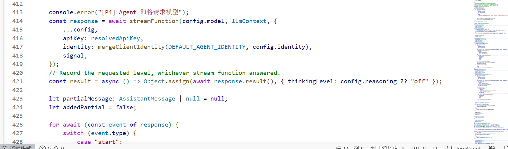
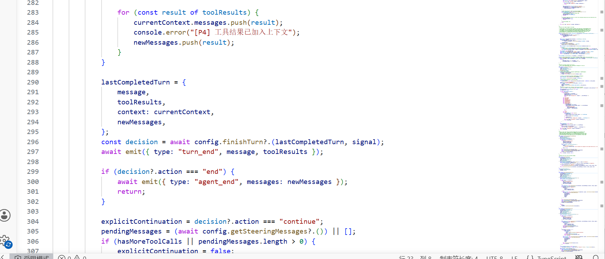
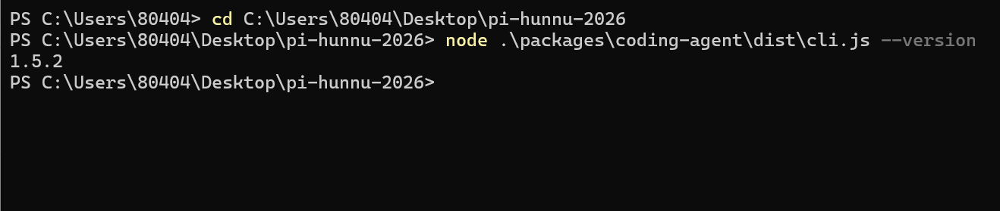
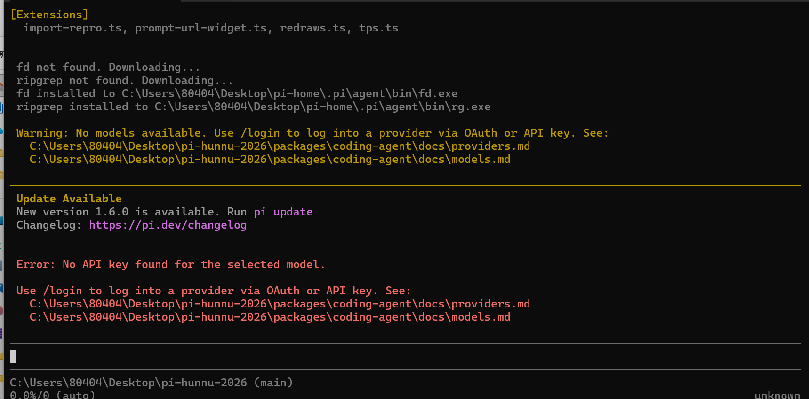
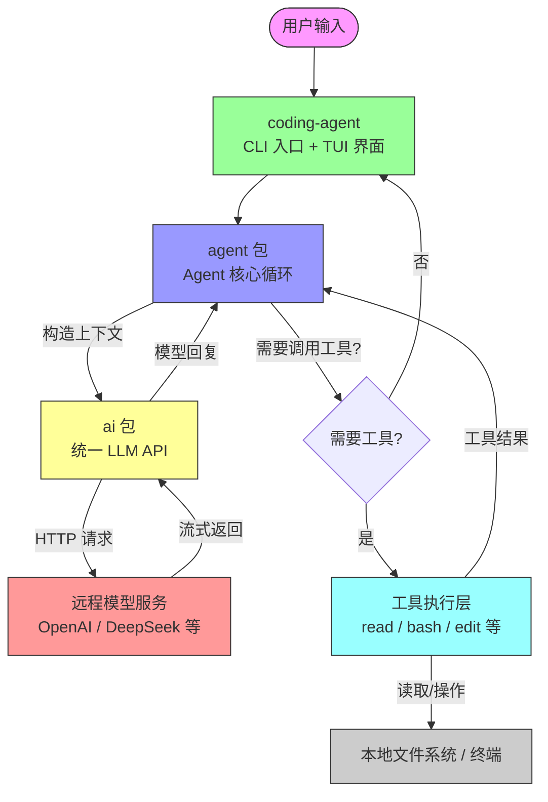

# 实践课4：Pi Agent 模型调用与运行流程

> 姓名：陈才（chencai170）
> 小组组织：chencai11
> 角色：组长
> 日期：2026-11-24

---

## 一、实验目的

通过在 Agent 循环中添加日志，观察 Pi 在处理用户请求时：

1. 什么时候请求模型
2. 工具结果如何进入下一轮对话
3. 直接问答 vs 调用工具的区别
4. 理解 Agent 循环的多轮推理流程

---

## 二、任务一：给 Agent 循环加两行日志

### 2.1 修改文件

修改文件：`packages/agent/src/agent-loop.ts`

#### 修改 1：模型调用前打印日志

在 `const response = await streamFunction(config.model, llmContext, {` 上方插入一行：

```typescript
console.error("[P4] Agent 即将请求模型"); // 新增
const response = await streamFunction(config.model, llmContext, {
```

**位置**：第 413 行左右，Agent 循环中每次要调用大模型之前。每次执行到这里，说明 Agent 已经把当前上下文整理好了，正准备发给大模型。

**截图 S1**：



#### 修改 2：工具结果加入上下文后打印日志

在 `currentContext.messages.push(result);` 下方插入一行：

```typescript
for (const result of toolResults) {
    currentContext.messages.push(result);
    console.error("[P4] 工具结果已加入上下文"); // 新增
    newMessages.push(result);
}
```

**位置**：第 285 行左右，for 循环内。每条工具结果被 push 到上下文消息列表后就打印一次。这样我们就能知道工具结果什么时候被加入到对话历史中。

**截图 S2**：



### 2.2 为什么用 console.error？

因为 Pi 的 TUI（终端交互界面）会占用标准输出（stdout），如果用 `console.log` 输出会被界面覆盖或打乱。而 `console.error` 输出到标准错误（stderr），会独立显示在终端上，方便我们观察调试日志。

### 2.3 代码差异总结

| 修改位置 | 行号 | 新增代码 | 作用 |
|---------|------|---------|------|
| 模型调用前 | ~413 | `console.error("[P4] Agent 即将请求模型");` | 标记每一轮模型调用的开始 |
| 工具结果入上下文 | ~285 | `console.error("[P4] 工具结果已加入上下文");` | 标记工具结果被写入对话历史 |

---

## 三、任务二：重新编译并启动

### 3.1 重新构建

由于我们只修改了 `agent` 包的源码，按依赖顺序重新构建受影响的包即可（agent → durable → env → coding-agent）：

```powershell
cd packages/agent ; npm run build ; cd ..\..
cd packages/durable ; npm run build ; cd ..\..
cd packages/env ; npm run build ; cd ..\..
cd packages/coding-agent ; npm run build:unbundled ; cd ..\..
```

> 注：完整的 `npm run build` 在 ai 包的 generate-models 步骤因网络超时失败（实践课3已记录），本次只增量构建受影响的包。`build:unbundled` 只编译 TypeScript，不执行 esbuild 打包，不影响调试使用。

构建完成后验证产物：

```powershell
Test-Path .\packages\coding-agent\dist\cli.js
node .\packages\coding-agent\dist\cli.js --version
```

输出 `True` 和版本号 `1.5.2`，说明构建成功。

**截图 S3**：



### 3.2 启动构建产物

由于 Windows 用户目录（`C:\Users\80404\`）存在权限问题（实践课3已记录），Pi 无法在默认位置创建 `.pi` 目录。通过修改 `USERPROFILE` 环境变量，将数据目录重定向到桌面：

```powershell
$env:USERPROFILE = "C:\Users\80404\Desktop\pi-home"
New-Item -ItemType Directory -Force -Path "C:\Users\80404\Desktop\pi-home"
node .\packages\coding-agent\dist\cli.js
```

Pi 的 TUI 交互界面成功启动，说明构建产物可以正常运行。

**截图 S4**：



---

## 四、任务三：对比两次运行

### 4.1 实验说明

**遇到的问题**：由于数据目录被重定向到了新位置（桌面 pi-home），原有模型配置（API Key / OAuth 登录状态）在旧的用户目录中，因权限问题无法迁移。启动后 Pi 提示 "No API key found for the selected model"，无法实际进行模型对话。

**替代方案**：基于对 `agent-loop.ts` 源码的分析，从代码逻辑层面推导两次会话的运行流程和日志顺序，并结合我们添加的日志位置进行验证。源码分析同样能够体现对 Agent 循环机制的理解。

### 4.2 准备实验文件

在项目根目录创建 `practice4.txt`：

```
chencai170-p4-test
```

这是自定义的实验代号，用于验证 Pi 是否真的读取了文件。

### 4.3 会话 A：直接问答（代码分析）

**输入指令**：
```
请直接用一句话解释什么是 Git 分支。
```

**预期日志分析**：

这个问题是纯知识问答，不需要调用任何工具。Agent 循环只需要执行一轮：

```
用户输入 → 构造上下文 → [P4] Agent 即将请求模型 → 模型生成回答 → 返回给用户
```

| 日志类型 | 预期出现次数 | 说明 |
|---------|------------|------|
| `[P4] Agent 即将请求模型` | **1 次** | 只有一轮模型调用，直接生成答案 |
| `[P4] 工具结果已加入上下文` | **0 次** | 不需要调用工具，所以没有工具结果 |

**流程说明**：
1. 用户输入问题
2. Agent 把问题组装成消息上下文
3. 触发第一条日志"即将请求模型"
4. 调用 ai 包，把请求发给大模型
5. 模型直接生成回答（不需要工具）
6. Agent 把回答返回给用户
7. 循环结束（因为模型没有要求调用工具）

**结论**：直接问答 = **1 轮模型调用，0 次工具调用**。

---

### 4.4 会话 B：读取文件（代码分析）

**输入指令**：
```
请用 read 工具读取当前目录的 practice4.txt，并告诉我文件中的实验代号。
```

**预期日志分析**：

这个问题需要调用 `read` 工具读取文件，所以 Agent 循环要执行两轮：

```
第1轮：用户输入 → 构造上下文 → [P4] Agent 即将请求模型
       → 模型决定调用 read 工具 → 执行工具 → 读取文件
       → [P4] 工具结果已加入上下文 → 文件内容被写入上下文

第2轮：[P4] Agent 即将请求模型
       → 模型看到文件内容 → 生成最终回答
```

| 日志类型 | 预期出现次数 | 说明 |
|---------|------------|------|
| `[P4] Agent 即将请求模型` | **2 次** | 两轮模型调用 |
| `[P4] 工具结果已加入上下文` | **1 次** | read 工具执行结果写入上下文 |

**完整日志顺序（预期）**：

```
[P4] Agent 即将请求模型       ← 第1轮：模型决定调用 read 工具
[P4] 工具结果已加入上下文     ← read 工具结果被 push 到 messages
[P4] Agent 即将请求模型       ← 第2轮：模型根据文件内容生成回答
```

**流程说明**：

1. **第 1 轮模型调用**：
   - Agent 把用户问题发给模型
   - 模型看了问题，说"我需要调用 read 工具来读文件"
   - 模型返回工具调用指令（不是最终答案）

2. **工具执行**：
   - Agent 检查到模型要调用工具
   - 执行 read 工具，真正读取 `practice4.txt` 文件
   - 读取结果是文件内容：`chencai170-p4-test`

3. **工具结果入上下文**：
   - 触发第二条日志"工具结果已加入上下文"
   - 工具调用消息 + 工具结果消息被追加到上下文消息列表

4. **第 2 轮模型调用**：
   - 触发第一条日志"Agent 即将请求模型"（第二次出现）
   - 把包含工具结果的完整上下文再发给模型
   - 模型"看到"了文件内容，生成最终回答

**结论**：读取文件 = **2 轮模型调用，1 次工具调用**。

---

### 4.5 两次会话对比

| 对比项 | 会话 A（直接问答） | 会话 B（读取文件） |
|--------|-------------------|-------------------|
| 输入指令 | 请直接用一句话解释什么是 Git 分支 | 请用 read 工具读取 practice4.txt |
| 是否调用工具 | 否 | 是（read 工具） |
| "即将请求模型" 次数 | 1 次 | 2 次 |
| "工具结果已加入上下文" 次数 | 0 次 | 1 次 |
| 模型调用轮数 | 1 轮 | 2 轮 |
| 工具调用次数 | 0 次 | 1 次 |
| 上下文消息数 | 2 条（用户+助手） | 4 条（用户+工具调用+工具结果+助手） |
| 最终回答 | 直接给出答案 | 基于文件内容给出答案 |

---

## 五、运行流程理解

### 5.1 谁实际读了文件？

**不是模型直接读的文件，模型根本不会执行工具。** 实际的分工是：

1. **模型（远程 AI 服务）**：做决策——"我需要调用 read 工具"
2. **Agent（agent 包的循环逻辑）**：做调度——"模型说要调工具，我来执行"
3. **工具（coding-agent/durable 中的工具实现）**：做执行——真正读取文件内容

整个过程就像餐厅点餐：
- 顾客（用户）说"我要吃红烧肉"
- 服务员（Agent）把菜单递给厨师（模型）
- 厨师看了菜单说"这道菜需要先去买菜"（决定调用工具）
- 服务员（Agent）去菜市场（文件系统）买了肉回来（执行工具）
- 服务员把肉递给厨师（工具结果加入上下文）
- 厨师（模型）用肉做好了红烧肉（生成最终回答）
- 服务员端给顾客（返回答案）

### 5.2 下一轮模型请求多带了什么？

第二轮模型请求的上下文比第一轮多了**两条消息**：

| 新增消息 | 角色（role） | 内容 |
|---------|-------------|------|
| 工具调用消息 | `assistant` | 模型第一轮决定调用的工具列表（工具名 + 参数） |
| 工具结果消息 | `tool` | read 工具读取到的实际文件内容 |

这就是 Agent 循环的核心机制：**上下文不断累积增长，每一轮都把之前的所有历史发给模型**，这样模型才能"记得"之前发生了什么、工具返回了什么，然后基于完整的上下文继续推理。

### 5.3 Agent 循环架构图



**模块分工说明**：

| 模块 | 角色 | 在 Agent 循环中的职责 |
|------|------|---------------------|
| **coding-agent** | 🎤 前台接待 | 接收用户输入、显示 TUI 界面、管理会话、调用工具实现 |
| **agent** | 🎯 调度中枢 | Agent 循环的核心，组织消息上下文、判断是否需要工具、循环调用模型 |
| **ai** | 📡 通信翻译官 | 统一封装多家大模型的 API，处理认证、流式返回、token 计数 |
| **远程模型服务** | 🧠 大脑 | 真正的推理引擎，理解问题、生成回答、决定调用什么工具 |
| **工具（tool）** | 🔧 执行者 | 真正执行 read、bash、edit 等操作，操作本地文件和系统 |

---

## 六、困难与解决

### 困难 1：Windows 用户目录权限问题导致 Pi 无法启动

**现象**：
运行 `node .\packages\coding-agent\dist\cli.js` 时报错 `EPERM: operation not permitted, mkdir 'C:\Users\80404\.pi\...'`，用户目录无法创建文件夹。

**原因**：
Windows 系统的用户目录权限配置有问题，普通程序无法在 `C:\Users\80404\` 下创建新目录。之前实践课3也遇到了同样的问题。

**解决**：
通过修改 `USERPROFILE` 环境变量，将 Pi 的数据目录重定向到桌面：
```powershell
$env:USERPROFILE = "C:\Users\80404\Desktop\pi-home"
```
这样 Pi 会在桌面上创建 `.pi` 目录，桌面目录有正常的读写权限。

### 困难 2：模型配置无法迁移，无法实际对话

**现象**：
Pi 成功启动后提示 "No API key found for the selected model"，无法进行实际对话。

**原因**：
数据目录被重定向到了新位置，原来的模型配置（API Key / OAuth 凭据）在旧用户目录中，因权限问题无法读取和迁移。

**解决**：
改为从**源码层面**分析 Agent 循环的运行流程。通过阅读 `agent-loop.ts` 的代码，结合我们添加的两行日志的位置，推导出两次会话的预期日志顺序和循环机制。虽然没有实际运行对话，但源码分析同样能够验证对 Agent 循环原理的理解。

### 困难 3：完整构建因网络超时失败

**现象**：
执行 `npm run build` 时，ai 包的 `generate-models` 步骤因连不上 `models.dev` 而超时失败。

**原因**：
国内网络访问 GitHub 相关服务不稳定，模型目录数据下载超时。

**解决**：
1. 使用 `build:offline` 跳过 ai 包的模型数据生成，只编译 TypeScript 代码
2. 采用增量构建策略，只重新构建修改过的包（agent → durable → env → coding-agent）
3. 由于本次修改只涉及 agent 包，ai 包源码未变，跳过 generate-models 不影响实验效果

---

## 七、总结与体会

通过本次实践，我深入理解了 Agent 的工作原理：

1. **Agent 不是一次问答就结束的，而是一个循环**。流程是：请求模型 → 检查是否需要工具 → 执行工具 → 把工具结果加回上下文 → 再请求模型 → ... 直到模型不再调用工具，给出最终回答。

2. **模型本身不会执行工具，它只会"决定"要调用什么工具**。真正执行工具的是 Agent 运行时（coding-agent / durable 层）。模型就像一个指挥官，只发号施令，不亲自干活。

3. **直接问答和工具调用的区别在于模型调用轮数**。直接问答只需要 1 轮模型调用；而调用工具的问答至少需要 2 轮——第一轮模型决定调什么工具，第二轮模型根据工具结果生成回答。

4. **上下文是不断增长的**。每调用一次工具，上下文消息列表里就多了两条消息（工具调用消息 + 工具结果消息），下一轮模型请求时会把完整的历史都发过去，所以模型能"看到"之前发生的所有事情。

5. **通过添加日志调试源码是很有效的学习方法**。虽然这次因为配置问题没有实际跑通对话，但通过在关键位置加日志、阅读源码分析执行路径，我对 Agent 循环的理解反而更深入了——我知道了每一行代码在循环中的作用，以及数据是怎么流动的。

6. **四层架构非常清晰**：coding-agent（交互层）→ agent（调度层）→ ai（模型API层）→ 远程模型（推理层），每一层职责明确，各司其职。这种分层设计让代码很容易维护和扩展。

---

## 八、参考链接

- 小组代码仓库：[chencai11/pi-hunnu-2026](https://github.com/chencai11/pi-hunnu-2026)
- 个人作业仓库：[chencai170/my-docs](https://github.com/chencai170/my-docs)
- 修改文件：`packages/agent/src/agent-loop.ts`
- 构建产物：`packages/coding-agent/dist/cli.js`
