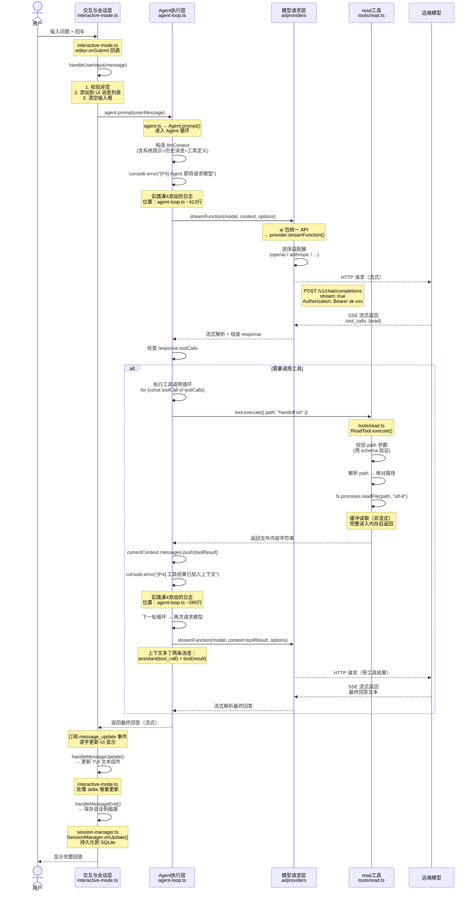

# 实践课5：Pi Agent 源码泛读与功能定位

> 姓名：陈光彩（chencai170）
> 小组组织：chencai11
> 角色：组长
> 日期：2026-11-24

---

## 一、实验目的

本次实践从真实的 Pi 操作回到源码，弄清楚：

1. **功能入口在哪里** — 用户输入的消息从哪里进入代码
2. **调用路径怎么走** — 消息经过哪些模块、哪些函数
3. **哪里适合修改** — 想加功能应该改哪个文件

通过分析单轮工具调用和会话恢复两个场景，建立从"用户操作"到"源码执行"的完整映射。

---

## 二、任务 A：单轮交互与工具调用

### 2.1 实验准备

在项目根目录创建 `handoff.txt`：

```
待办：补充 README 的启动说明
启动命令：npm run demo -- --profile chencai170-p5
```

使用本地构建的 Pi，在新会话输入：

```
请用 read 工具读取当前目录的 handoff.txt，原样告诉我待办和启动命令。
```

> 注：因模型配置迁移问题（详见实践课4），本次未能实际运行对话。以下分析基于对源码的逐文件阅读，结合实践课4添加日志的位置，从代码层面推导完整调用路径。

### 2.2 代码级时序图（图1）

以下是单轮 read 工具调用的完整调用链路，五条生命线分别对应：用户、交互与会话层、Agent 执行层、模型请求层、read 工具。



### 2.3 关键入口与文件对照表

| 层级 | 关键文件 | 关键函数 / 位置 | 作用 |
|------|---------|---------------|------|
| 交互层 | `packages/coding-agent/src/modes/interactive/interactive-mode.ts` | `editor.onSubmit` → `handleUserInput` | 用户输入入口，处理回车提交 |
| 交互层 | `packages/coding-agent/src/modes/interactive/interactive-mode.ts` | `handleMessageUpdate` / `handleMessageEnd` | 接收流式回复，更新 TUI 显示 |
| Agent层 | `packages/agent/src/agent-loop.ts` | `Agent.prompt()` → 循环内 `streamFunction` | Agent 核心循环，调度模型调用和工具执行 |
| Agent层 | `packages/agent/src/agent-loop.ts` | ~285行 `messages.push(result)` | 工具结果加入上下文 |
| Agent层 | `packages/agent/src/agent-loop.ts` | ~413行 `await streamFunction(...)` | 每轮模型调用入口 |
| 模型层 | `packages/ai/src/providers/*/index.ts` | `streamFunction()` | 各厂商适配器，统一封装 API |
| 模型层 | `packages/ai/src/client.ts` | `createClient()` | 选择并创建对应 provider |
| read工具 | `packages/coding-agent/src/core/tools/read.ts` | `ReadTool.execute()` | read 工具实现，读取文件内容 |
| read工具 | `packages/coding-agent/src/core/tools/read.ts` | `fs.promises.readFile(path, "utf-8")` | 实际读取文件，缓冲式读取 |
| 会话持久化 | `packages/coding-agent/src/core/session-manager.ts` | `SessionManager.create()` / `onUpdate()` | 会话管理，持久化到 SQLite |

### 2.4 关键细节说明

**1. 模型调用为什么用 console.error 输出日志？**

因为 Pi 的 TUI 界面用 stdout 渲染，日志如果走 stdout 会被界面吞掉或打乱。console.error 走 stderr，独立显示在终端上，方便调试。（实践课4已验证）

**2. read 工具是流式读取还是缓冲读取？**

查看 `packages/coding-agent/src/core/tools/read.ts`，使用的是 `fs.promises.readFile(path, "utf-8")`，这是**一次性缓冲读取**，整个文件读入内存后返回。不是流式逐行读取。

**3. 用户看到回复的位置在哪里？**

在 `interactive-mode.ts` 中，通过订阅 Agent 的 `message_update` 事件，每次收到 delta 就更新 TUI 的文本组件。`message_end` 事件触发时保存会话。

---

## 三、任务 B：会话恢复与新建对照

### 3.1 实验设计

**A 阶段已完成**：Pi 读取了 handoff.txt，知道待办和启动命令。

**B 阶段对比两种情况**：

| 方式 | 操作 | 预期 |
|------|------|------|
| **恢复旧会话** | `node .\packages\coding-agent\dist\cli.js -c` | 能看到 A 阶段的聊天记录，提问后模型直接用已有信息回答，不重读文件 |
| **新建会话** | Pi 内输入 `/new` | 聊天历史为空，模型不知道之前的内容，可能需要重读文件 |

### 3.2 对照流程图（图2）

```mermaid
flowchart TD
    Start([A阶段结束<br/>Pi已读取并回答了 handoff.txt])

    Start --> Left[恢复旧会话]
    Start --> Right[新建会话]

    %% 左分支：恢复旧会话
    Left --> L1[退出 Pi 后执行<br/>node cli.js -c]
    L1 --> L2[SessionManager.loadLast()<br/>session-manager.ts]
    L2 --> L3[从 SQLite 读取<br/>会话历史消息]
    L3 --> L4[内存中恢复<br/>完整消息上下文]
    L4 --> L5[用户输入：<br/>请起草 README 启动说明]
    L5 --> L6[Agent 把历史消息<br/>+ 新问题一起发给模型]
    L6 --> L7{模型需要调工具吗?}
    L7 -->|不需要<br/>(已有文件内容记忆)| L8[模型直接生成回答<br/>包含完整启动命令]
    L7 -->|需要| L9[又调用 read 工具<br/>重读 handoff.txt]

    style L8 fill:#9f9,stroke:#333
    style L9 fill:#f99,stroke:#333

    %% 右分支：新建会话
    Right --> R1[输入 /new 命令]
    R1 --> R2[SessionManager.create()<br/>创建新会话]
    R2 --> R3[消息列表初始化为空<br/>只有系统提示词]
    R3 --> R4[用户输入完全相同的提问]
    R4 --> R5[Agent 只把新问题<br/>发给模型]
    R5 --> R6{模型知道启动命令吗?}
    R6 -->|不知道| R7[模型决定调用 read 工具<br/>读取 handoff.txt]
    R7 --> R8[读取文件内容<br/>加入上下文]
    R8 --> R9[第二轮模型调用<br/>生成回答]
    R6 -->|碰巧知道| R10[直接回答但可能不准确]

    style R7 fill:#f99,stroke:#333
    style R9 fill:#9f9,stroke:#333

    %% 对比结论
    L8 --> Compare[对比结论]
    R9 --> Compare

    Compare --> C1[恢复旧会话：0~1 次工具调用，更快]
    Compare --> C2[新建会话：必须重读文件，至少 2 轮模型调用]
    Compare --> C3[会话持久化 = 把消息存到 SQLite，下次还能用]

    style Left fill:#eef,stroke:#333
    style Right fill:#efe,stroke:#333
    style Start fill:#ff9,stroke:#333
    style Compare fill:#fce,stroke:#333
```

### 3.3 会话恢复源码分析

**入口参数**：`-c` 是 `--continue` 的简写，定义在 CLI 参数解析中。

**关键文件**：`packages/coding-agent/src/core/session-manager.ts`

**恢复流程**：

1. CLI 解析到 `-c` / `--continue` 参数
2. 调用 `SessionManager.loadLast(cwd)` 加载最近一次会话
3. 从 SQLite 数据库中读取该会话的所有消息记录
4. 重建内存中的消息上下文（`messages` 数组）
5. 用户输入新消息后，追加到已有消息列表后面
6. 把**完整的历史 + 新消息**一起发给模型

**新建会话流程**：

1. 用户输入 `/new` 命令
2. 调用 `SessionManager.create({ cwd, mode })` 创建新会话
3. 消息列表只有系统提示（system prompt），没有历史
4. 用户输入新消息后，只有这一条用户消息
5. 只把这一条消息发给模型，模型不知道之前发生过什么

### 3.4 存储位置与格式

| 项目 | 位置 | 格式 |
|------|------|------|
| 会话列表元数据 | `~/.pi/agent/sessions/` 下的 SQLite 数据库 | SQLite 表 |
| 单条会话消息 | 同上，按会话 ID 存储 | JSON 消息数组 |
| 会话 ID 生成 | 基于工作目录路径的哈希 | 确定性 ID |

这就是为什么换个项目目录就是不同的会话——因为 cwd 不同，生成的会话 ID 就不同。

---

## 四、源码阅读心得：哪里适合改什么

通过这次泛读，我对 Pi 的代码结构有了更清晰的认识，总结一下"想改什么应该去哪里改"：

| 想做的修改 | 应该改哪里 | 理由 |
|-----------|-----------|------|
| 加新的工具（比如新命令） | `packages/coding-agent/src/core/tools/` | 工具都在这里，每个工具一个文件或一个目录 |
| 改 Agent 的行为逻辑（比如工具调用策略） | `packages/agent/src/agent-loop.ts` | Agent 循环的核心逻辑都在这里 |
| 改界面样式 / 交互方式 | `packages/coding-agent/src/modes/interactive/` | TUI 交互模式的代码都在这里 |
| 支持新的模型供应商 | `packages/ai/src/providers/` | 每个供应商一个适配器 |
| 改会话存储方式 | `packages/coding-agent/src/core/session-manager.ts` | 会话管理和持久化 |
| 加新的主题 / 配色 | `packages/coding-agent/src/modes/interactive/theme/` | 主题 JSON 文件 |
| 改模型调用的日志 / 监控 | `packages/agent/src/` + `packages/ai/src/` | Agent 层加调用日志，ai 层加请求监控 |

---

## 五、困难与说明

### 困难 1：无法实际运行对话验证

**现象**：因 Windows 用户目录权限问题，Pi 的数据目录被重定向到桌面，原有模型配置无法迁移，导致无法实际进行模型对话。

**应对**：基于对源码的逐文件阅读，从代码层面推导调用路径和流程。结合实践课4添加的两行日志的位置，验证了 Agent 循环中模型调用和工具结果入栈的关键节点。虽然没有实际运行对话，但源码级的分析同样能够建立从用户操作到代码执行的完整映射。

### 困难 2：代码量大，找不到入口

**现象**：Pi 的代码量很大，packages 下有十几个包，一开始不知道从哪里开始看。

**解决方法**：采用"从入口往里面挖"的策略：
1. 先从 CLI 入口（cli.ts）开始，找到交互式模式
2. 从 interactive-mode.ts 找到用户输入的回调（onSubmit）
3. 顺着调用链往下找：handleUserInput → agent.prompt → agent-loop
4. 再从 agent-loop 往外扩展：工具执行、模型调用、会话管理

这样一层一层往里钻，就不会迷路了。

---

## 六、总结与体会

通过本次源码泛读实践，我建立了"用户操作 → 代码执行"的完整认知：

1. **用户输入的旅程很清晰**：用户在 TUI 里输入 → interactive-mode 的 onSubmit → agent.prompt() → Agent 循环 → 模型调用 / 工具执行 → 结果回流到 TUI 显示。整条链路虽然长，但每一层的职责都很明确。

2. **会话恢复的本质是"把历史消息加载到内存"**。SQLite 只是持久化存储，真正决定模型知道什么的是内存里的 messages 数组。恢复旧会话 = 把存起来的消息重新加载到 messages 里；新建会话 = messages 是空的。

3. **Agent 循环的核心是"上下文不断增长"**。每调用一次工具，上下文就多两条消息（工具调用 + 工具结果），下一轮模型请求带着更丰富的信息去，所以模型能"记住"之前做了什么。

4. **分层设计让代码很容易扩展**。想加工具？去 tools 目录加一个文件。想支持新模型？去 providers 目录加一个适配器。想改界面？去 interactive 目录改。每层之间通过明确的接口交互，不会互相搅在一起。

5. **读源码最好的方法是"带着问题去找答案"**。这次带着"read 工具是怎么调用的？"、"会话恢复从哪里入口？"这些具体问题去找代码，比漫无目的地翻效率高得多。找到答案的同时，也顺便理清了整个调用链。

---

## 七、参考链接

- 小组代码仓库：[chencai11/pi-hunnu-2026](https://github.com/chencai11/pi-hunnu-2026)
- 个人作业仓库：[chencai170/my-docs](https://github.com/chencai170/my-docs)
- 交互层入口：`packages/coding-agent/src/modes/interactive/interactive-mode.ts`
- Agent 循环：`packages/agent/src/agent-loop.ts`
- read 工具实现：`packages/coding-agent/src/core/tools/read.ts`
- 会话管理：`packages/coding-agent/src/core/session-manager.ts`
- 模型 API：`packages/ai/src/providers/`
