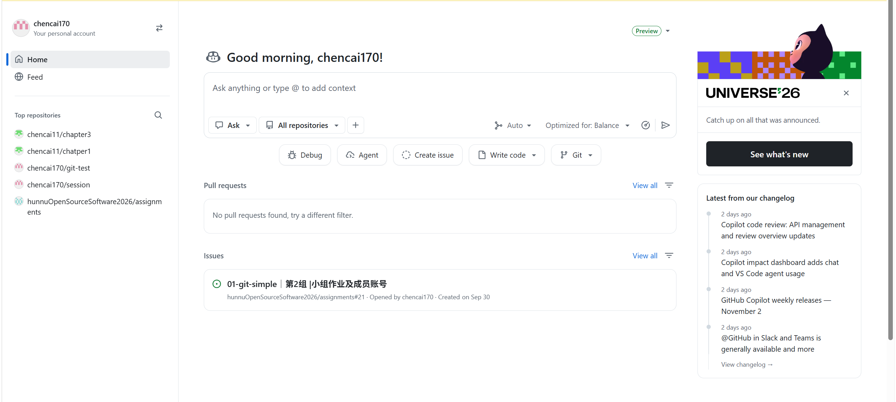

# 实践项目2：个人实验报告

## 1. 基本信息

- **GitHub 登录名**：chencai170
- **个人仓库地址**：https://github.com/chencai170/my-docs
- **最终网站地址**：https://chencai170.github.io/my-docs/

---

## 2. 实践过程与关键截图

### 2.1 仓库创建

**操作**：登录 GitHub，点击右上角 `+` → `New repository`，Owner 选择本人账号，仓库名设为 `my-docs`，选择 Public，勾选添加 README，创建仓库。确认默认分支为 `main`。

**结果**：成功创建了一个名为 `my-docs` 的公开仓库，默认分支为 main。



### 2.2 项目结构与 MkDocs 配置

**操作**：在本地克隆仓库后，按照要求创建了完整的文件结构：

```
my-docs/
├── .github/
│   └── workflows/
│       └── deploy.yml    # GitHub Actions 工作流配置
├── docs/
│   ├── index.md          # 首页
│   ├── about.md          # 关于页
│   ├── guide.md          # 使用指南
│   └── api.md            # API 参考
├── report/
│   ├── README.md         # 本报告
│   └── images/           # 截图存放目录
├── mkdocs.yml            # MkDocs 配置文件
├── requirements.txt      # Python 依赖
├── .gitignore            # Git 忽略规则
└── README.md             # 仓库说明
```

**各部分作用说明**：
- **`docs/`**：存放网站的 Markdown 源文件，是我们真正编写和维护的内容。MkDocs 会读取这个目录下的文件来生成网站。
- **`nav`**：在 `mkdocs.yml` 中配置，定义网站的导航菜单结构。每个菜单项对应 `docs/` 下的一个 Markdown 文件。
- **`site/`**：MkDocs 构建后自动生成的静态网站目录，包含 HTML、CSS、JS 等文件。这个目录不需要手工编写，也不应该提交到 Git。


### 2.3 本地构建与预览

**操作**：创建 Python 虚拟环境，安装依赖，执行构建和预览。

**使用的命令**：
```bash
python -m venv .venv
source .venv/Scripts/activate   # Windows Git Bash
python -m pip install -r requirements.txt
python -m mkdocs build --strict
python -m mkdocs serve
```

**检查内容**：
1. 构建是否成功（有无报错或警告）
2. 首页是否正常显示，文字和链接是否正确
3. 关于页的表格是否渲染正常
4. 使用指南的代码块是否有高亮
5. API 参考页的 JSON 示例是否格式正确
6. 四个页面之间的相互跳转是否都能正常工作
7. 顶部导航栏是否显示完整

**结果**：本地构建成功，四页内容均正常显示，导航和链接跳转无误。


### 2.4 Pages 设置

**操作**：进入仓库 `Settings` → `Pages` → `Build and deployment` → `Source` 选择 `GitHub Actions`。同时确认 Actions 权限设置允许运行工作流。

**为什么选择 GitHub Actions 而不是分支发布**：
- 不需要手动创建 `gh-pages` 分支
- 不需要管理额外的分支和令牌
- 构建和部署都在 Actions 中自动化完成，流程更清晰
- 官方推荐的部署方式，与最新的 Pages 架构一致


### 2.5 Actions 首次构建和部署

**操作**：将所有文件提交并推送到 main 分支后，自动触发了工作流运行。

**工作流执行过程**：
1. **build 任务**：拉取源码 → 配置 Python 3.12 → 配置 Pages → 安装依赖 → 执行 `mkdocs build --strict` → 上传 site 目录构建产物
2. **deploy 任务**：等待 build 成功 → 使用官方 deploy-pages 动作将构建产物发布到 GitHub Pages

**结果**：build 和 deploy 两个任务均成功完成，网站成功上线。


### 2.6 网站访问与四页导航检查

**操作**：使用浏览器访问部署后的网站地址，逐一打开四个页面进行检查。

**检查结果**：
- ✅ 首页：正常显示，作者信息和导航链接正确
- ✅ 关于页：表格渲染正常，技术栈说明清晰
- ✅ 使用指南：代码块高亮正常，命令说明完整
- ✅ API 参考：返回示例格式正确，错误码表格显示正常
- ✅ 顶部导航：四个页面之间跳转流畅
- ✅ 搜索功能：输入关键词能正常搜索


### 2.7 第二次推送与自动更新验证

**操作**：在 `docs/index.md` 末尾添加了一句"自动部署验证：这是我第二次推送后更新的内容。"，提交并推送到 main 分支。

**验证过程**：
1. 推送后没有手动触发部署，等待 Actions 自动运行
2. 观察到新的工作流运行被自动触发
3. 等待 build 和 deploy 均成功
4. 刷新网页（使用无痕模式排除缓存干扰）
5. 确认首页底部出现了新增的文字

**结论**：自动部署机制正常工作，修改文档后推送即可自动更新网站。

- **对应提交链接**：https://github.com/chencai170/my-docs/commit/替换为你的提交哈希
- **对应 Actions 运行链接**：https://github.com/chencai170/my-docs/actions/runs/替换为你的运行ID


---

## 3. 问题与解决

> 记录你实际遇到的问题。如果没有遇到错误，说明你核对了哪些日志和配置。

### 问题 1：（示例，按需删除）

**现象**：

**关键日志**：

**原因分析**：

**解决操作**：

**结果**：

### 无问题情况说明

如果整个过程比较顺利，没有遇到明显错误，请在此处说明你核对了哪些内容来确保一切正常，例如：

- 核对了 `mkdocs build --strict` 没有任何警告
- 核对了 Actions 日志中每个步骤都显示绿色对勾
- 核对了网站四个页面的所有链接都能正常跳转
- 核对了第二次推送后网站内容确实更新了

---

## 4. 原理理解

### 1. `docs/` 和 `site/` 各保存什么？为什么不用手工修改 `site/`？

**docs/** 保存的是**源代码**——用 Markdown 编写的文档内容，以及配置文件 `mkdocs.yml`。这是我们真正维护和修改的东西，人写起来方便，版本控制也友好。

**site/** 保存的是**构建产物**——MkDocs 自动生成的 HTML、CSS、JavaScript 等静态文件。这些文件是给浏览器看的，不适合人直接编辑。

不用手工修改 site/ 的原因：
- site/ 是自动生成的，每次构建都会被覆盖，手动修改没有意义
- 手工修改 HTML 容易出错，而且下次构建就丢了
- 正确的做法是修改 docs/ 下的源文件，然后重新构建

### 2. 本次工作流在什么情况下自动运行？

工作流在以下两种情况下会运行：

1. **push 触发**：当 `main` 分支上有文件推送，且修改的文件属于以下路径时：
   - `docs/**`（文档内容变更）
   - `mkdocs.yml`（配置变更）
   - `requirements.txt`（依赖变更）
   - `.github/workflows/deploy.yml`（工作流自身变更）

   这意味着只修改 `report/` 或 `README.md` 不会触发部署，因为这些文件不在 paths 列表中。

2. **workflow_dispatch**：允许在 GitHub Actions 页面手动点击运行，主要用于首次调试和排错。

### 3. build 与 deploy 两个任务有什么区别？

**build（构建）任务**：
- 负责把源代码变成可发布的静态文件
- 具体工作：拉取代码、装 Python、装依赖、运行 mkdocs build、把生成的 site/ 打包上传为 artifact
- 产出是一个"构建产物包"，还没有发布出去

**deploy（部署）任务**：
- 负责把构建产物发布到 GitHub Pages 上
- 具体工作：下载 build 上传的 artifact，通过官方 Pages 机制发布
- 需要特殊权限（`pages: write` 和 `id-token: write`）

两者的关系通过 `needs: build` 体现——deploy 必须等 build 成功了才会执行。如果构建失败，就不会部署。

可以理解为：build 是"做饭"，deploy 是"端上桌"。饭做好了才能端，饭做坏了就不端了。

### 4. 只修改 `report/README.md` 会触发部署吗？为什么？

**不会触发部署。**

原因在工作流的 `on.push.paths` 配置中。只有当推送修改了以下路径的文件时才会触发：
- `docs/**`
- `mkdocs.yml`
- `requirements.txt`
- `.github/workflows/deploy.yml`

`report/README.md` 不在这个列表里，所以修改报告不会触发重新构建和部署。

**这样设计是合理的**：报告是给老师和自己看的过程记录，不属于网站内容。每次改报告都重新部署一次既浪费时间又没必要。网站内容只和 `docs/` 及配置文件有关。

### 5. 本次方案为何无需创建 gh-pages 分支？

因为使用的是 GitHub Pages 最新的 **Actions 部署方式**，而不是传统的"从分支发布"方式。

传统的 gh-pages 分支方式：
- 需要手动创建一个专门的分支
- 把构建产物（site/）提交到这个分支
- Pages 从这个分支读取文件并发布
- 需要管理两个分支，比较麻烦

现在的 Actions 部署方式：
- 构建完成后，用 `upload-pages-artifact` 把 site/ 打包上传
- 然后用 `deploy-pages` 直接发布这个 artifact
- 整个过程不需要额外的分支，也不需要手动管理
- 由 GitHub 官方的 Pages 基础设施来托管构建产物

简单说：以前是"把产物存在一个分支里，让 Pages 去读"；现在是"把产物直接上传给 Pages 服务，它自己管"。后者更简洁，也更符合 CI/CD 的理念。
